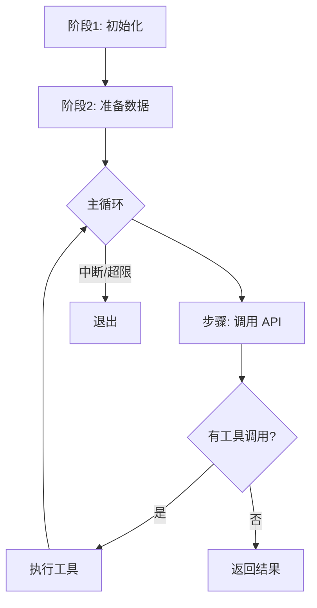

# 框架/复杂控制流 输出模板

适用于：循环、状态机、管道、长函数（>500行）等非 CRUD 代码。

---

## `{函数/模块名}` 链路分析

### 一句话

{这个函数/模块做什么，用一句非技术人员也能懂的话}

### 流程图

> 先让人 10 秒看懂整体结构，再展开每个阶段。



### 核心数据结构

> 这一节回答：「贯穿整个流程的关键变量是什么，它在各阶段怎么变」

**`{变量名}`**（类型：{如 List[Dict]}）

```
初始化时:  [{system_msg}, {user_msg}]
循环中:    每轮追加 assistant 回复 + tool 结果 → 不断增长
压缩后:    老消息被摘要替换，长度骤降
最终:      包含完整对话历史，持久化到 DB
```

---

### 阶段 1：{阶段名}

**做什么**：{一句话}

**为什么**：{解决什么问题，不做会怎样}

**关键步骤**：

| # | 操作 | 为什么 | 位置 |
|---|------|--------|------|
| 1 | `agent._ensure_db_session()` | 确保有持久化目标，否则对话历史丢失 | `:383` |
| 2 | 重置重试计数器（6+ 个计数器归零） | 上一轮的重试状态不能污染本轮 | `:442-456` |
| 3 | `_restore_primary_runtime()` | 上轮若降级到了 fallback 模型，本轮先尝试恢复主模型 | `:417` |
| 4 | 清理僵死 TCP 连接 | 上次 API 调用可能留下断开的连接，不清理会卡死 | `:466-475` |

**数据变化**：`messages` 从 `conversation_history` 浅拷贝 + 追加 `user_message`

---

### 阶段 2：{阶段名}

{同上格式}

---

### 主循环（核心）

**循环条件**：`api_call_count < max_iterations && budget.remaining > 0`

**每轮做什么**（按顺序）：

| # | 步骤 | 为什么 | 位置 |
|---|------|--------|------|
| 1 | 检查 `interrupt_requested` | 用户发了新消息或手动中断 | `:806` |
| 2 | 消耗迭代预算 | 防止无限循环消耗 token | `:822` |
| 3 | 排空 `/steer` 指令 | 用户在上轮 API 调用期间发的引导文本，注入到 tool 消息里让模型本轮看到 | `:874` |
| 4 | 修复消息序列 | 清理 role 交替错误（如 tool→user 连续），否则 API 返回空内容 | `:937` |
| 5 | 构建 `api_messages`（从 `messages` 复制） | 注入 memory context、清理内部字段、不污染原始 messages | `:945` |
| 6 | 应用 prompt cache 标记 | 对 Claude 注入 cache_control 断点，减少 ~75% 输入 token 费用 | `:1024` |
| 7 | 调用 LLM API | 核心 HTTP 请求，后台线程执行，主线程监听中断 | `:下方` |
| 8 | 解析响应 → 有 tool_calls 则执行 → 追加结果 → continue；纯文本则 break | 这是循环的分支点 | `:下方` |

**循环退出条件**：
- 模型返回纯文本（正常结束）
- `interrupt_requested`（用户中断）
- 迭代预算耗尽
- API 连续失败且无 fallback

---

### 异常与边界处理（第一遍跳过的部分）

| 场景 | 处理方式 | 位置 |
|------|----------|------|
| 429/5xx | 切换 fallback provider 重试 | `:{line}` |
| 空响应 | 重试 N 次后 break | `:{line}` |
| {其他} | {处理} | `:{line}` |

---

**分析深度**：{追踪了多少行 / 总行数}  
**未覆盖**：{哪些分支/功能没展开，如 codex_app_server 模式、streaming 路径}
