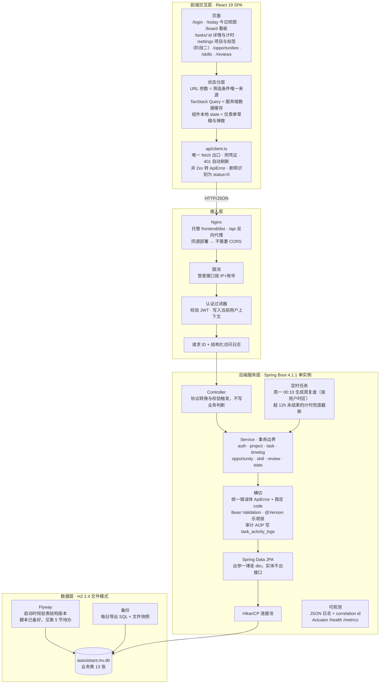
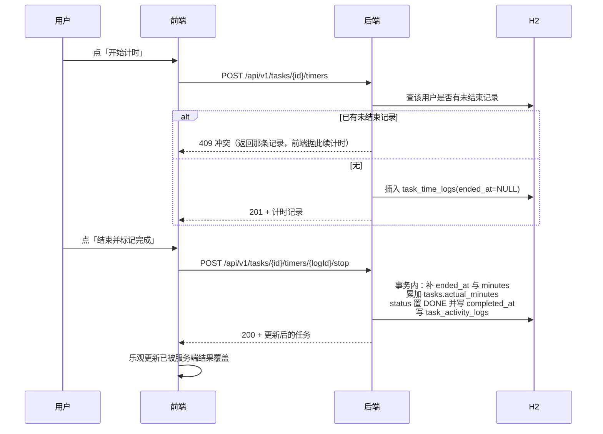
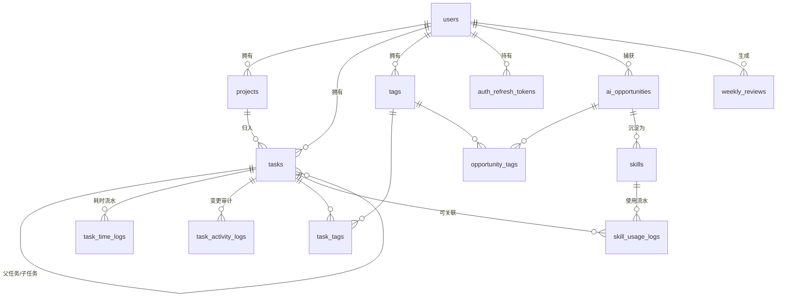

# 工作管理系统 · 架构与表结构设计

日期：2026-10-18
状态：设计待确认（未动业务代码）
参照文件：`docs/工作管理_AI机会.xlsx`（四张表，均为表头、无数据）

本文只覆盖两件交付物：**系统整体架构**与**数据库表结构**。业务代码的改造留到设计确认之后。

## 0. 决策记录

### 0.1 已由你确认

| 决策 | 结论 |
| --- | --- |
| 用户模型 | 多用户 + 账号登录，各业务表带 `owner_id`，数据按拥有者隔离 |
| 数据库与运行形态 | 开发与生产都用 H2 文件模式（单体部署） |
| 范围 | 四张表全量建模；本轮实现「任务管理」主线，其余三块建表 + 只读接口占位 |
| 「智能」边界 | 不做模型调用。`AI可替代?`／`AI替代方案` 等字段本轮为人工填写 |
| DDL 落地位置 | 保留在 `backend/src/main/resources/db/migration/V1__init_schema.sql`，接入 Flyway 时启用 |

### 0.2 我按默认值定了、你可以直接推翻的

| 项 | 默认取法 | 理由 |
| --- | --- | --- |
| 认证方式 | Spring Security + JWT（HS256，2 小时）+ 刷新令牌存库（30 天，可吊销） | 前端是 SPA，无状态校验省一层；刷新令牌落库才能「登出即失效」 |
| 密码存储 | bcrypt（cost 10） | 够用且无需额外基建 |
| 接口版本 | 新增接口统一挂 `/api/v1`，现有 `/api/tasks` 保留一个版本周期 | 没有版本前缀，后续破坏性改动只能靠前端同步发版 |
| 分页 | 列表接口统一 `page`/`size`/`sort`，返回 `{items,total,page,size}` | 任务量上来后一次性返回全量必然要改，早改便宜 |
| 错误体 | 在现有 `ApiError` 上加稳定的 `code`（如 `TASK_NOT_FOUND`） | message 会变，前端判断分支需要不变的标识 |
| 优先级 | `priority` 是存储字段，默认由 `importance × urgency` 推导，手工改过就以手工值为准 | Excel 里两者并存，说明确实存在「矩阵算出来是 P2 但我要先做」的情况 |
| 实际耗时 | 明细表 `task_time_logs` 是权威数据，`tasks.actual_minutes` 是冗余累计列，同事务维护 | 看板要排序、要算估差，每次聚合 5000 条流水不划算 |
| 周复盘数字 | 生成那一刻的快照落库，不随后续补录变动；实时数字走 `/api/v1/stats` 现算 | 复盘是历史档案，数字事后漂移会让人不再信任它 |
| 时区 | `users.timezone`（默认 `Asia/Shanghai`），周按 ISO-8601 计算 | 反例：用服务器时区算「今天」，出国或换机器后历史统计会整体位移 |
| 软删除 | `deleted_at`，所有查询带 `deleted_at IS NULL` | 任务误删需要能找回 |
| 并发控制 | 实体加 `@Version` 乐观锁 | 两个标签页同时改同一个任务时，后者应该报冲突而不是静默覆盖 |
| 登录限流 | 失败 5 次锁 15 分钟，计数放内存 | 单实例部署，不为此引入 Redis |

### 0.3 本轮明确不做

WebSocket 实时推送（用 TanStack Query 的失效重取代替）、附件上传、团队/工作空间与任务指派、任务依赖图（只做父子两层）、模型调用与自动建议、移动端原生壳、多语言。

## 1. 系统整体架构

### 1.1 架构图

### 1.2 各层职责与约束

**前端交互层**（沿用现有 React 19 + Vite 8 + TS 6 + Tailwind 4，新增 `react-router` 与 `@tanstack/react-query`）

- 现有 `App.tsx` 把列表状态放在组件里，页面一多就会出现「同一个任务在三个页面各有一份状态」。因此引入路由 + 服务端状态缓存，并约定：筛选条件只存在 URL 里（可分享、可前进后退），服务端数据只存在查询缓存里，组件本地 state 只放表单草稿与弹窗开关。
- 目录职责沿用现有划分，补两层：`pages/`（路由级页面）、`hooks/`（`useTasks`、`useAuth` 等把查询缓存与 API 组合起来）。`api/` 与 `components/` 的分工不变。
- 交互约定：改状态、勾完成走乐观更新，失败回滚并提示；计时器前端每秒刷新的是**显示**，落库只发生在「开始」与「结束」两次请求上，避免每秒打库；跨标签页以服务端未结束记录为准。
- 可访问性：看板拖拽必须同时提供键盘可达的改状态方式（行内下拉或快捷键），不能只有鼠标拖拽；计时中的任务用 `aria-live` 播报。

**接入层**（生产由 Nginx 承担，开发期由 Vite 代理顶替）

- Nginx 托管 `frontend/dist` 并把 `/api` 反代到后端，前后端同源，因此不需要任何 CORS 配置——与现有脚手架的处理一致。
- 认证过滤器在 Controller 之前完成 JWT 校验并写入当前用户上下文，Service 层据此强制 `owner_id` 过滤。**越权防护放在 Service 层**：所有按 id 取数据的查询都带 `owner_id` 条件，而不是「取出来再比对」，后者漏一个分支就是越权。

**后端服务层**（单体 Spring Boot，按功能分包，沿用现有约定）

- 请求链：认证 → 请求 ID 与访问日志 → 限流（仅登录）→ Controller → Service（事务）→ Repository → HikariCP → H2。
- 横切能力集中三处：统一错误体（含稳定 `code`）、参数校验、审计写入。审计用 AOP 在 Service 方法上织入，避免每个方法里手写一遍。
- 定时任务两条：周一 00:10 按用户时区生成上一周复盘；把超过 12 小时仍未结束的计时记录兜底截断，防止忘点「结束」把实际耗时算成几十小时。
- 出参一律经 `dto` 包的 record，实体不出接口——这条现有代码已经在做，继续执行。

**数据层**

- H2 文件模式，数据在 `backend/data/aiassistant.mv.db`。Flyway 负责表结构版本（脚本已写好，接入步骤见第 5 节）。
- 备份两条腿：每日 `SCRIPT TO` 导出可读的 SQL（结构 + 数据，便于跨版本恢复），以及库文件快照。两者都要写恢复演练步骤——没演练过的备份不能算备份。

### 1.3 一条关键链路的数据流

## 2. 数据库表结构设计

### 2.1 表清单（13 张）

| 分组 | 表 | 作用 | 本轮 |
| --- | --- | --- | --- |
| 账号 | `users` | 账号、时区、状态 | 实现 |
| 账号 | `auth_refresh_tokens` | 刷新令牌（只存哈希，可吊销） | 实现 |
| 任务 | `projects` | 项目（只归档不删除） | 实现 |
| 任务 | `tasks` | 任务主体，含优先级矩阵、耗时累计、AI 可替代标注 | 实现 |
| 任务 | `task_time_logs` | 耗时流水，实际耗时的权威来源 | 实现 |
| 任务 | `task_activity_logs` | 变更审计，只追加 | 实现 |
| 任务 | `tags` / `task_tags` / `opportunity_tags` | 标签与两张关联表（不做多态关联，便于建索引） | 实现 |
| 机会 | `ai_opportunities` | 每日 AI 机会 | 建表 + 只读接口 |
| Skill | `skills` | Skill 库，含来源机会外键 | 建表 + 只读接口 |
| Skill | `skill_usage_logs` | 每次使用的节省时间流水 | 建表 + 只读接口 |
| 复盘 | `weekly_reviews` | 周复盘，统计字段为生成时快照 | 建表 + 只读接口 |

### 2.2 实体关系

整条链路的语义：**任务**（要干的事）→ 其中重复的部分沉淀为 **AI 机会**（能不能让 AI 替）→ 验证可行的变成 **Skill**（怎么替，含提示词）→ Skill 每次使用记一条 **节省时间流水** → **周复盘**把这一周的产出与收益固化成快照。

### 2.3 Excel 列 → 字段映射

**任务管理**（14 列，主干）

| Excel 列 | 字段 | 说明 |
| --- | --- | --- |
| 任务ID | `tasks.id` | 主键 |
| 任务 | `tasks.title` | 不超过 200 字 |
| 项目/来源 | `tasks.project_id` + `tasks.source` | 项目建表（可分组、可筛选）；来源是自由文本（会议、邮件、临时插单） |
| 重要性 | `tasks.importance` | HIGH/MEDIUM/LOW |
| 紧急性 | `tasks.urgency` | HIGH/MEDIUM/LOW |
| 优先级 | `tasks.priority` | P0–P3，默认由重要性×紧急性推导，可覆盖 |
| 状态 | `tasks.status` | TODO/DOING/BLOCKED/DONE/CANCELLED（在现有三态上补 BLOCKED 与 CANCELLED） |
| 截止日期 | `tasks.due_on` | 只到日，不含时刻 |
| 预计耗时(min) | `tasks.estimated_minutes` | 可空（新建时常常估不出来） |
| 实际耗时(min) | `tasks.actual_minutes` + `task_time_logs` | 冗余累计列 + 流水明细，估值对比才有依据 |
| AI可替代? | `tasks.ai_replaceable` | 三态：NULL 未评估 / TRUE / FALSE |
| AI替代方案 | `tasks.ai_replacement_note` | 自由文本 |
| 下一步 | `tasks.next_action` | 自由文本 |
| 备注 | `tasks.notes` | 自由文本 |

Excel 里没有、但生产上必需的补充列：`owner_id`、`parent_task_id`（子任务）、`description`、`completed_at`、`sort_order`、`version`、`created_at`/`updated_at`/`deleted_at`。

**每日AI机会**（8 列）→ `ai_opportunities`

| Excel 列 | 字段 |
| --- | --- |
| 日期 | `occurred_on`（DATE） |
| 今天最烦/最重复的一件事 | `pain_point` |
| 频率 | `frequency`：DAILY/WEEKLY/MONTHLY/OCCASIONAL/ONE_OFF |
| AI能不能替 | `ai_can_replace`：YES/PARTIAL/NO/UNKNOWN |
| 具体怎么替 | `replacement_approach` |
| 最小实验(2分钟能开始) | `minimal_experiment` |
| 状态 | `status`：CAPTURED/EXPERIMENTING/VALIDATED/DROPPED |
| 标签 | `opportunity_tags` → `tags` |

**Skill库**（8 列）→ `skills`

| Excel 列 | 字段 |
| --- | --- |
| Skill名称 | `name` |
| 触发场景 | `trigger_scenario` |
| 输入 | `input_spec` |
| 输出 | `output_spec` |
| 提示词/步骤 | `prompt_or_steps`（CLOB，可能很长） |
| 状态 | `status`：DRAFT/ACTIVE/DEPRECATED |
| 已节省时间 | `saved_minutes_total` + `skill_usage_logs`（累计值 + 流水） |
| 下次优化 | `next_improvement` |

**周复盘**（8 列）→ `weekly_reviews`

| Excel 列 | 字段 |
| --- | --- |
| 周次 | `week_key`（ISO-8601，如 `2026-W42`），与 `period_start`/`period_end` 一起存 |
| 日期范围 | `period_start` / `period_end` |
| 完成任务数 | `completed_task_count`（生成时快照） |
| 捕获AI机会数 | `captured_opportunity_count`（快照） |
| 落地Skill数 | `landed_skill_count`（快照） |
| 本周最大摩擦 | `biggest_friction` |
| 下周最小实验 | `next_experiment` |
| 备注 | `notes` |

Excel 没有、我补的一列：`saved_minutes_total`。理由：Skill 库有「已节省时间」，周复盘却不汇总它，复盘就答不出「这周靠 Skill 省了多少时间」这个最该回答的问题。

### 2.4 索引设计与对应查询

原则：每个索引都要对应一条真实查询，没有查询支撑的索引是写入负担。

| 表 | 索引 | 支撑的查询 |
| --- | --- | --- |
| `tasks` | `(owner_id, deleted_at, status, due_on)` | 看板按状态分列，按截止日排序 |
| `tasks` | `(owner_id, deleted_at, due_on)` | 今日视图：未删 + 截止日范围，不带状态过滤。第三列是 `due_on` 而非 `status`，因为带上 `status` 会切断后续的范围扫描 |
| `tasks` | `(owner_id, project_id)` | 按项目筛选 |
| `tasks` | `(owner_id, completed_at)` | 周复盘统计完成数 |
| `tasks` | `(parent_task_id)` | 展开子任务 |
| `task_time_logs` | `(task_id, started_at)` / `(owner_id, started_at)` / `(ended_at)` | 任务的耗时明细、按人统计、找未结束的计时 |
| `ai_opportunities` | `(owner_id, deleted_at, occurred_on)`、`(owner_id, deleted_at, status)` | 按日期的机会流、按状态的工作台 |
| `skills` | `(owner_id, deleted_at, status)`、`(source_opportunity_id)` | Skill 列表、从机会反查沉淀结果 |
| `skill_usage_logs` | `(skill_id, used_on)`、`(owner_id, used_on)` | 单个 Skill 的收益曲线、按人按周汇总 |
| `weekly_reviews` | 唯一 `(owner_id, week_key)`、`(owner_id, period_start)` | 一周一条、复盘列表 |
| `tags` | 唯一 `(owner_id, name)`、`(owner_id, deleted_at)` | 标签去重、标签列表 |
| `task_activity_logs` | `(task_id, created_at)`、`(actor_id, created_at)` | 任务详情里的变更历史、按人审计 |
| `users` | 唯一 `username`、唯一 `email` | 登录、找回 |
| `projects` | 唯一 `(owner_id, name)`、`(owner_id, archived_at)` | 项目重名拦截、项目列表 |

### 2.5 约束设计

- 枚举列一律存字符串 + `CHECK` 约束。H2 的 `ENUM` 类型迁移到别的库时要重写，字符串 + CHECK 是各库通用的写法。加新取值需要新的迁移脚本，这是有意的：让「新增一个状态」变成一次需要评审的动作，而不是随手写进去。
- 可空性按业务语义定，不留「不知道」：`estimated_minutes` 可空（估算本来就可能没有），`actual_minutes` 不可空（默认 0）；`ai_replaceable` 可空，因为「未评估」和「评估为否」是两回事。
- 外键的删除行为分三类：从属明细（耗时流水、标签关联、刷新令牌）`ON DELETE CASCADE`；审计表 `RESTRICT`（任务有审计记录就删不掉，先归档）；业务引用（项目、父任务）`RESTRICT`（不允许静默丢失归属信息）。
- 自引用防护交给数据库：`CHECK (parent_task_id IS NULL OR parent_task_id <> id)`。层级只做父子两层，深度限制在服务层。

### 2.6 H2 带来的三个取舍（已实测）

这三条是选 H2 之后必须接受的写法差异，都已在真实 H2 2.4.240 上验证：

1. **H2 不支持部分索引**。`CREATE INDEX ... WHERE deleted_at IS NULL` 会直接语法报错（错误码 42000-240）。因此所有服务软删查询的索引都把 `deleted_at` 放在前导列，用「参与索引」代替「过滤索引入口」。
2. **软删与唯一约束冲突**。`(owner_id, name)` 唯一索引会把已软删的标签/项目也算进去，于是删除后无法用同名重建。H2 又没有部分唯一索引可用，折中办法是服务层软删时把 `name` 改写成「原名 (已删除 #id)」。迁移到 PostgreSQL 时这个改写逻辑可以删掉，换成部分唯一索引。
3. **H2 会自动为外键建索引**。`tasks.owner_id` 上会存在一个 H2 自建的 `FK_TASKS_OWNER_INDEX_*`。因此单列 `owner_id` 索引不必手写；但复合索引（`owner_id` 打头 + 后续列）仍然要显式建，外键索引替代不了。

### 2.7 冗余字段与一致性

三处冗余，都是拿空间换查询速度，各有明确的维护点：

| 冗余字段 | 权威来源 | 维护方式 |
| --- | --- | --- |
| `tasks.actual_minutes` | `task_time_logs.minutes` | 停止计时、手工补录的同一事务内累加 |
| `skills.saved_minutes_total` / `usage_count` | `skill_usage_logs` | 记录使用时同事务累加 |
| `weekly_reviews` 的四个统计数 | 各业务表 | 生成复盘时一次性算好并固化，不再更新 |

前两处要配一个每日对账任务：用明细重算一遍，与冗余值比对，不一致就告警并按明细修正。没有对账，冗余字段迟早会和明细对不上，而且没人会发现。

## 3. 与现有脚手架的关系

| 现状 | 处理 |
| --- | --- |
| `task` 模块（实体/仓储/服务/接口同包） | 保留分包方式，`Task` 实体补字段，接口路径升到 `/api/v1` |
| `tasks` 表（6 列，`ddl-auto: update` 建的） | 由 V1 迁移脚本接管。**开发库里已有一张同名的旧表**，首次接入 Flyway 要删掉 `backend/data/aiassistant.mv.db` 重建（里面只有脚手架验证数据）；生产环境不存在这个问题 |
| `TaskStatus`（TODO/DOING/DONE） | 扩展为五态，前端 `TASK_STATUSES` 常量数组同步扩展 |
| `App.tsx` 单页单状态 | 拆成 `pages/` + 查询缓存，`api/client.ts` 增加 401 刷新与 `X-Request-Id` |
| `ApiError` 统一错误体 | 加稳定 `code` 字段，其余结构不变 |

## 4. 分阶段

| 阶段 | 内容 | 完成标志 |
| --- | --- | --- |
| 一（本轮） | 账号登录 + 任务主线：项目、标签、子任务、计时、耗时流水、变更审计、今日视图与看板 | 能用真实账号登录，把一件事从录入、计时、改状态走到完成，并在详情里看到完整耗时与变更历史 |
| 二 | 每日 AI 机会、Skill 库、Skill 使用流水、周复盘生成与页面、统计看板 | 一条机会能被捕获、转成 Skill、记录使用与节省时间，并在周复盘里汇总出来 |
| 三 | 容器化、Nginx、备份与恢复演练、监控告警、CI 流水线 | 停机发布有脚本、备份能恢复、5xx 与慢请求有告警 |

## 5. 待办：把已备好的迁移脚本接上

1. `backend/pom.xml` 增加 `org.springframework.boot:spring-boot-starter-flyway`（4.1.1 坐标已在 Maven Central 确认；H2 支持在 `flyway-core` 内，**没有**独立的 `flyway-database-h2` 模块，不要去找）。
2. `application.yml`：`spring.jpa.hibernate.ddl-auto` 由 `update` 改为 `validate`，开启 `spring.flyway.enabled`。
3. 删除开发库 `backend/data/aiassistant.mv.db` 后首次启动，确认 13 张表由 V1 建立。
4. 用 H2 控制台核对表与索引数量，并跑一次完整业务冒烟。
5. 明确回滚方式：Flyway 对 H2 不支持 `undo` 迁移，回滚靠「停服 → 恢复备份 → 回退到上一个应用版本」。

## 6. 风险

| 风险 | 影响 | 缓解 |
| --- | --- | --- |
| H2 嵌入式文件模式只能被一个进程打开 | 后端**不能**多实例水平扩展；滚动发布会有停机窗口；`mvnw test` 与运行中的后端抢文件锁（脚手架文档已记录过一次） | 接受单实例；发布安排在低峰并停机；把「换 PostgreSQL」列为明确的演进路径（表与索引结构可直接映射，DDL 需按第 6 项口径改写） |
| 冗余字段与明细漂移 | 看板上的「实际耗时」和明细对不上，用户不再信任数字 | 同事务维护 + 每日对账告警 |
| 周复盘存在两套数字语义 | 复盘里是快照、看板里是实时，用户以为出错 | 复盘页面显式标注「生成于 X 时刻」，实时数字放在单独的统计页 |
| 未结束的计时记录 | H2 没有部分唯一索引，无法用数据库拦住「同一人两条并行计时」 | 服务层校验 + 超 12 小时兜底截断 + 前端提示已有计时在跑 |
| 迁移到 PostgreSQL 的改写量 | DDL 里 `CLOB`、无部分索引、identity 写法都是 H2 口径 | 结构（列与索引）可直接映射；改写集中在类型与索引两处，预计一个迁移脚本 |

## 7. 验证记录

表结构不是「写完就算」，`V1__init_schema.sql` 已用本机真实的 H2 2.4.240 跑过一遍（脚本：临时目录 `h2verify/SchemaVerify.java`），27 项全部通过：

| 验证项 | 结果 |
| --- | --- |
| V1 脚本在空库上执行 | 通过，建出 13 张表；库内共 49 个非主键索引（含 H2 为外键自动建的那些，我显式建的比这个数少） |
| 未填邮箱的账号可以有多行 | 通过（H2 唯一索引允许多行 NULL） |
| 用户名重复、非法状态、非法优先级、负耗时被拒绝 | 通过 |
| 任务不能把自己设为父任务 | 通过 |
| 同一 owner 标签重名被拒绝，不同 owner 同名可用 | 通过 |
| 正在计时（`ended_at` 为空）允许存在 | 通过 |
| 结束时间早于开始时间被拒绝 | 通过 |
| 同一用户同一周复盘唯一、周期起止顺序反了被拒绝 | 通过 |
| Skill 提示词以 CLOB 存 2000 字并读回 | 通过 |
| 项目下还有任务时删除项目被拒绝 | 通过 |
| 有审计记录的任务删不掉（审计不被静默清掉） | 通过 |
| 任务硬删后耗时流水被级联清掉 | 通过 |
| 灌入 5000 条任务后，三条主力查询分别命中为它们设计的索引 | 通过（优化器实际选中 `ix_tasks_owner_alive_status_due`、`ix_tasks_owner_alive_due`、`ix_tasks_owner_project`） |

未验证的部分（属于阶段一的实现工作）：并发下的乐观锁冲突行为、计时器跨标签页、审计 AOP、定时任务、备份恢复演练。

## 8. 下一步

设计确认后再动手，顺序是：第 5 节接入 Flyway → 阶段一后端（账号 → 任务 → 计时 → 审计）→ 阶段一前端（登录 → 今日视图 → 看板 → 详情与计时）。每步都跑一次真实验证，不留「写完但没跑过」的东西。
